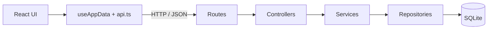
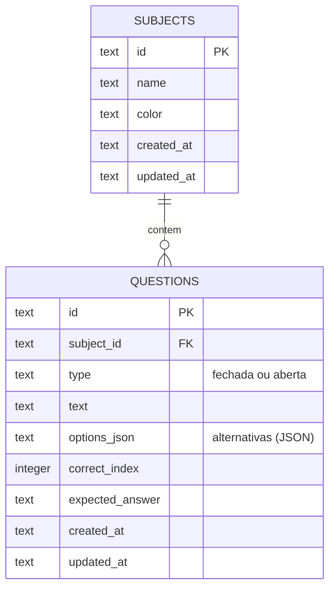

# 📋 Banco de Questões

Aplicação full-stack para **estudo e prática**: organize questões por matéria, cadastre questões fechadas (múltipla escolha) e abertas (com gabarito) e monte provas aleatórias para treinar.

## Sumário

- [Sobre o projeto](#sobre-o-projeto)
- [Funcionalidades](#funcionalidades)
- [Tecnologias](#tecnologias)
- [Arquitetura](#arquitetura)
- [Modelo de dados](#modelo-de-dados)
- [Como executar](#como-executar)
- [Variáveis de ambiente](#variáveis-de-ambiente)
- [API](#api)
- [Decisões técnicas](#decisões-técnicas)
- [Limitações conhecidas e roadmap](#limitações-conhecidas-e-roadmap)
- [Autor](#autor)

## Sobre o projeto

O projeto nasceu como um protótipo de arquivo único (HTML + React via CDN) e foi convertido em uma aplicação full-stack em **TypeScript** nos dois lados, com uma API REST em camadas e persistência real em banco de dados.

O objetivo foi praticar arquitetura de backend (separação de responsabilidades, tratamento centralizado de erros, migrations) e a integração com um frontend em React.

## Funcionalidades

- **Matérias:** criar, editar e excluir, cada uma com nome e cor. Excluir uma matéria apaga também as questões dela.
- **Questões fechadas:** enunciado, de 2 a 6 alternativas e uma alternativa correta.
- **Questões abertas:** enunciado e resposta esperada (gabarito de referência).
- **Modo prova:** escolha a matéria (ou todas), o tipo de questão (todas, fechadas ou abertas) e a quantidade. O backend sorteia as questões.
- **Correção:** as fechadas são corrigidas ao final da prova, com a nota. As abertas aparecem lado a lado com o gabarito, para autoavaliação.
- **Dados de exemplo:** um seed cria a matéria "Sistemas Embarcados" com 27 questões (20 fechadas e 7 abertas).

## Tecnologias

| Camada | Tecnologias |
|---|---|
| Backend | Node.js, Express 4, TypeScript, `node:sqlite` (SQLite nativo do Node), dotenv, cors |
| Frontend | React 19, TypeScript, Vite |
| Qualidade | `tsc` (strict), oxlint |
| Desenvolvimento | `tsx` (execução e watch de TypeScript) |

## Arquitetura

O backend segue uma arquitetura em camadas. Cada camada tem uma responsabilidade e só conversa com a seguinte:



| Camada | Responsabilidade |
|---|---|
| **Routes** | Mapeiam método + URL para um controller |
| **Controllers** | Traduzem HTTP para chamadas de service (sem regra de negócio) |
| **Services** | Regras de negócio e validações; lançam `HttpError` com status e mensagem |
| **Repositories** | Único lugar com SQL (consultas parametrizadas) |
| **Middlewares** | `errorHandler` central: responde `{ "message": "..." }` com o status correto |

Os erros inesperados viram um `500` genérico, com log no servidor e sem vazar detalhes para o cliente.

### Estrutura de pastas

```
banco-de-questoes/
├── backend/
│   ├── database/migrations/001_init.sql   # schema em SQL puro
│   └── src/
│       ├── server.ts                      # ponto de entrada
│       ├── app.ts                         # monta o Express (CORS, JSON, rotas, erros)
│       ├── config/database.ts             # conexão SQLite + migrations
│       ├── routes/
│       ├── controllers/
│       ├── services/
│       ├── repositories/
│       ├── middlewares/errorHandler.ts
│       ├── types/index.ts                 # DTOs e HttpError
│       └── utils/                         # geração de id, runner do seed
└── frontend/
    └── src/
        ├── App.tsx                        # navegação entre telas por estado
        ├── hooks/useAppData.ts            # estado + operações via API
        ├── services/api.ts                # camada de chamadas HTTP
        ├── components/
        └── types/
```

## Modelo de dados



- `subject_id` usa `ON DELETE CASCADE` (com `PRAGMA foreign_keys = ON`).
- `type` tem um `CHECK` que aceita apenas `fechada` ou `aberta`.
- Os dois tipos de questão compartilham a tabela: campos que não se aplicam ao tipo ficam `NULL`.
- Os ids são UUIDs gerados no servidor.

## Como executar

### Pré-requisitos

- **Node.js 22.13 ou superior.** O módulo `node:sqlite` só funciona sem flag a partir dessa versão. Confira com `node -v`.

Ao iniciar o backend aparece o aviso `ExperimentalWarning: SQLite is an experimental feature`. É esperado: o módulo ainda é experimental no Node.

### 1. Backend

```bash
cd backend
npm install
cp .env.example .env
npm run dev          # http://localhost:3333/api
```

Opcional: popular o banco com a matéria de exemplo.

```bash
npm run seed
```

(ou `POST /api/seed` com o servidor rodando).

Build de produção: `npm run build` e depois `npm start`.

### 2. Frontend

Em outro terminal:

```bash
cd frontend
npm install
cp .env.example .env
npm run dev          # http://localhost:5173
```

Build de produção: `npm run build`. Para servir o resultado: `npm run preview`.

O arquivo do banco (`backend/database/data.sqlite`) é criado automaticamente na primeira execução, e as migrations são aplicadas na inicialização.

## Variáveis de ambiente

**Backend** (`backend/.env`)

| Variável | Padrão | Descrição |
|---|---|---|
| `PORT` | `3333` | Porta da API |
| `DATABASE_PATH` | `./database/data.sqlite` | Caminho do arquivo SQLite (relativo ao diretório de execução) |
| `CORS_ORIGIN` | `http://localhost:5173` | Origem(ns) permitida(s), separadas por vírgula |

**Frontend** (`frontend/.env`)

| Variável | Padrão | Descrição |
|---|---|---|
| `VITE_API_URL` | `http://localhost:3333/api` | URL base da API |

## API

Base: `http://localhost:3333/api`. Erros seguem o formato `{ "message": "..." }`.

| Método | Rota | Descrição | Sucesso |
|---|---|---|---|
| GET | `/health` | Verificação de saúde | 200 |
| GET | `/subjects` | Lista matérias | 200 |
| POST | `/subjects` | Cria matéria `{ name, color }` | 201 |
| PUT | `/subjects/:id` | Edita matéria | 200 |
| DELETE | `/subjects/:id` | Exclui matéria e suas questões | 204 |
| GET | `/questions` | Lista questões (filtro opcional `?subjectId=`) | 200 |
| POST | `/questions` | Cria questão | 201 |
| PUT | `/questions/:id` | Edita questão (campos opcionais; o que não for enviado é mantido) | 200 |
| DELETE | `/questions/:id` | Exclui questão | 204 |
| POST | `/exam/generate` | Sorteia questões `{ subjectId?, typeFilter, count }` | 200 |
| POST | `/seed` | Cria a matéria de exemplo (idempotente) | 201 |

Códigos de erro: `400` (dados inválidos), `404` (recurso não encontrado), `500` (erro interno).

### Exemplos

**Criar uma questão fechada**

```bash
curl -X POST http://localhost:3333/api/questions \
  -H "Content-Type: application/json" \
  -d '{
    "subjectId": "<ID_DA_MATERIA>",
    "type": "fechada",
    "text": "Qual a principal vantagem de um microcontrolador em relação a um microprocessador?",
    "options": [
      "Clock mais alto",
      "Periféricos integrados no mesmo chip",
      "Maior capacidade de memória externa",
      "Suporte nativo a sistemas desktop"
    ],
    "correctIndex": 1
  }'
```

`correctIndex` é a posição (começando em 0) da alternativa correta.

**Criar uma questão aberta**

```json
{
  "subjectId": "<ID_DA_MATERIA>",
  "type": "aberta",
  "text": "O que é firmware?",
  "expectedAnswer": "Software gravado em memória não volátil que controla diretamente o hardware."
}
```

**Gerar uma prova**

```json
{ "subjectId": "<ID_DA_MATERIA>", "typeFilter": "fechadas", "count": 5 }
```

`typeFilter` aceita `todas`, `fechadas` ou `abertas`. Sem `subjectId` (ou com `"all"`), usa todas as matérias.

## Decisões técnicas

- **Camadas (routes → controllers → services → repositories):** separa HTTP, regra de negócio e acesso a dados. Cada parte muda e é entendida de forma independente.
- **SQLite com `node:sqlite`:** zero instalação e um único arquivo, sem compilar módulos nativos. Ideal para um app de uso individual. O custo é ser um módulo experimental do Node.
- **SQL puro, sem ORM:** o domínio tem duas tabelas, e as consultas parametrizadas dão controle total e protegem contra SQL Injection.
- **Alternativas em `options_json`:** elas são sempre lidas e gravadas junto com a questão, então uma tabela separada traria joins sem ganho real.
- **Migrations em SQL puro:** o schema fica documentado e versionado no repositório e é aplicado na inicialização.
- **Sorteio no backend (Fisher-Yates):** garante uma permutação uniforme das questões.
- **Correção da prova no cliente:** adequada para um app de estudo pessoal, pois reduz requisições. Para um cenário multiusuário, a correção iria para o servidor.
- **Frontend sem biblioteca de rotas ou de estado:** são poucas telas, e um estado de `view` no `App.tsx` somado a um hook resolve o problema sem dependências extras.
- **Erros centralizados:** services lançam `HttpError`, e um único `errorHandler` padroniza as respostas.

## Limitações conhecidas e roadmap

O projeto é um MVP funcional. Estes são os pontos que já identifiquei e pretendo evoluir:

**Robustez**
- [ ] Validação de entrada em runtime com schemas (por exemplo, zod). Hoje a API confia nos tipos do TypeScript, que não existem em runtime.
- [ ] Respostas `400`/`413` para JSON inválido ou corpo grande (hoje retornam `500`).
- [ ] Exibir no frontend os erros da API ao salvar e excluir, e desabilitar o botão durante o envio.
- [ ] Ajustar o índice do gabarito no formulário de questão ao remover uma alternativa anterior à correta.

**Arquitetura**
- [ ] Controle de versão das migrations (tabela `schema_migrations`). Hoje todos os arquivos rodam a cada inicialização, o que só funciona porque a migration atual é idempotente.
- [ ] Repositories assíncronos e conexão com o banco injetável, para facilitar testes e uma futura troca de banco.
- [ ] Testes automatizados (unitários, de integração da API e E2E).
- [ ] Autenticação e CORS restritivo por padrão, caso a aplicação seja publicada. Hoje ela é pensada para uso local.

**Produto**
- [ ] Persistir tentativas e progresso por questão, com sorteio que priorize as questões erradas.
- [ ] Modo estudo (revelar resposta e autoavaliar).
- [ ] Questões com mais de uma alternativa correta.
- [ ] Importação e exportação de questões em JSON.
- [ ] Busca e filtros dentro da matéria, e detecção de questões duplicadas.

> O estado da prova em andamento existe apenas na memória do navegador: recarregar a página reinicia a prova.

## Autor

**Gustavo Anselmo**
[LinkedIn](https://www.linkedin.com/in/gustavo-anselmo-613779225/) · [GitHub]([https://github.com/seu-usuario](https://github.com/Gustavo-Anselmo)) · [E-mail](gustavoanselmo.dev@gmail.com)
